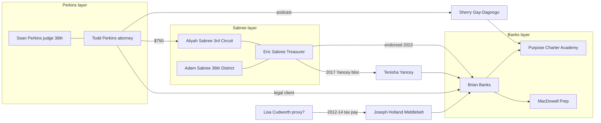

# OSINT SWEEP — BATCH 3 (Sep 20, 2026)

## Scope

| Task | Code | Focus |
|------|------|--------|
| Eric Sabree oral history & network ties | **A5** | Interviews, DPL/WSU collections, media, political machine, Banks/charter links |
| Todd Perkins podcast & media mining | **L3** | Podcast/YouTube, charter-school mentions, judicial politics, Sean Perkins |
| Lisa Cudworth full identification | **L6** | Identity, Banks/Holland nexus, licenses, donations, role in network |

**Methods:** Web search, public media indexes, cross-reference to repo OSINT (`HOLLAND_DEEP_DIVE_SEP17.md`, `OSINT_SWEEP_SEP20_BATCH1.md`, PACER targeted search logs).

---

# TASK 1 — Eric Sabree Oral History (A5)

## 1. Wayne State University oral history (`Eric Sabree oral history Wayne State`)

**NOT FOUND:** No Wayne State University oral history interview listing Eric R. Sabree as an interviewee.

**What exists at Wayne State instead:**

| Resource | URL | Relevance |
|----------|-----|-----------|
| *Blacks in the Labor Movement Oral History Project* (1967–1970, NAACP/Herbert Hill; Detroit auto/labor focus) | https://archives.wayne.edu/repositories/2/resources/1889 | Labor-movement transcripts; **Sabree not named** in collection description or search hits |

**Closest match (different institution):** Western Michigan University / Dream Storytelling Project (Detroit Muslim Storytelling), not WSU.

---

## 2. Detroit Public Library oral history collections

**NOT FOUND:** No DPL catalog or HistoryMakers entry tying **Eric Sabree** to a DPL-held oral history in public search results.

| Resource | URL | Notes |
|----------|-----|-------|
| DPL *History Makers* (subscription video oral history DB) | https://detroitpubliclibrary.org/research/subject/education | General African American oral history collection; **no Sabree profile surfaced** |
| DPL all databases index | https://detroitpubliclibrary.org/all-databases | Same — no Sabree-specific hit |

**Manual follow-up:** HistoryMakers requires library card; search inside portal for “Eric Sabree” / “Eric R. Sabree” (not completed in this sweep).

---

## 3. YouTube / podcast / broadcast — Eric Sabree

### Primary oral history (video)

| Field | Detail |
|-------|--------|
| **Title** | Oral History Interview with Eric Sabree |
| **Date recorded** | July 19, 2020 |
| **Interviewer** | Samayyah Cook |
| **Addendum** | Dr. Alisa Perkins (same date) |
| **Project** | Dream Storytelling Project / Detroit Muslim Storytelling Project (Dream of Detroit + WMU ScholarWorks) |
| **URL (archive landing + video)** | https://scholarworks.wmich.edu/dream-storytelling-interviews/37 |
| **Collection index** | https://scholarworks.wmich.edu/dream-storytelling-interviews/ |
| **Project background** | https://dreamofdetroit.org/dream-storytelling-project/ |
| **WMU library impact note** | https://wmich.edu/library/updates/2022/02/impact-report-capuring-community |

**Topics (from abstract / metadata):** Chicago-born, raised Detroit; Catholic Central + Cass Tech; MSU building construction; Detroit building inspector supervisor (~20 years); MSU law (1996); private practice → Wayne deputy treasurer → elected treasurer (2016); conversion to Islam; Masjid Wali Muhammad; co-founder Muslim Center; **27 years prison ministry**; recidivism reform; mosque role in raising children with wife Badriyyah.

**Notable admissions / biographical statements (oral history framing):** Long-form first-person narrative on Muslim community prison activism and need for city resources for returning citizens — useful for background, **not** Banks/charter admissions.

### Other Sabree media (not oral history, but on-request interviews)

| Date | Host / outlet | URL | Topics |
|------|---------------|-----|--------|
| Jul 30, 2020 | *Authentically Detroit* / BridgeDetroit (Orlando Bailey, Donna Givens) | https://www.bridgedetroit.com/podcast-county-treasurer-eric-sabree-on-property-taxes-interests-rates-and-activist-demands/ | Rafaeli v. Oakland County, Wayne foreclosure policy, Aug 2020 elections |
| Feb 27, 2022 | WDIV *Flashpoint* (Devin Scillian) | https://www.clickondetroit.com/flashpoint/2022/02/27/flashpoint-interview-wayne-county-treasurer-talks-approaching-property-tax-deadline/ | End of foreclosure moratoriums, property tax deadline |
| Nov 2024 (promo); Mar 2025 (promo) | MEA TV *Spotlight* (Wally Jadan) | LinkedIn promos: https://www.linkedin.com/posts/wally-jadan-06595a4b_on-our-new-episode-of-spotlight-we-welcome-activity-7264731446278332417-Fh5Q ; https://www.linkedin.com/posts/wally-jadan-06595a4b_in-tonights-new-spotlight-episode-we-hosted-activity-7306024059195047936-5anx | Career path, payment plans, low foreclosure claims; YouTube channel **@MEATVRadio** (full episode URLs vary by upload) |
| — | Catholic Central alumni profile | https://www.catholiccentral.net/eric-sabree | Archer housing commission, planning & development, treasurer arc |
| — | Official bio | https://www.waynecountymi.gov/Government/Elected-Officials/Treasurer/County-Treasurer | Land Bank chair, Election Commission, SEMCOG, Kiwanis |

---

## 4. Political machine / political connections

### Documented political alliances (media)

| Connection | Evidence | URL |
|------------|----------|-----|
| **2017 — Endorsed Tenisha Yancey** for MI House District 1 (Banks seat) | Sabree listed with Evans, Worthy, Napoleon; Banks financially supported Yancey but did not authorize use as public endorsement | https://wdet.org/2017/08/03/candidates-for-brian-banks-seat-talk-character-and-corruption/ ; https://www.fox2detroit.com/news/will-a-convicted-felon-replace-a-convicted-felon-in-lansing ; https://www.detroitnews.com/story/news/government/2017/08/09/sossi-request-recount-house-election/104430244/ |
| **2022 — Supported Brian Banks** for Wayne County Commission | Free Press: Banks “enjoys the support of” Evans, **Sabree**, Sheffield, Chang, Duggan | https://www.freep.com/story/news/local/michigan/2022/07/03/brian-banks-wayne-county-commissioner/7752526001/ |
| **Warren Evans bloc** | Evans ethics referral re: 2019 family auction reporting | https://www.detroitnews.com/story/news/local/wayne-county/2019/02/13/evans-calls-report-wayne-co-treasurer-extremely-troubling/2862446002/ ; https://www.deadlinedetroit.com/articles/21660/warren_evans_asks_prosecutor_and_county_ethics_board_to_look_into_treasurer_scandal |
| **2019 auction / ethics controversy** | News: family purchases at tax auction; U.S. Development Services; FBI reported interest; ethics board **dismissed** Evans complaint (July 2019) | https://www.metrotimes.com/news/ethics-board-dismisses-case-against-wayne-county-treasurer-eric-sabree-22105222/ ; https://outliermedia.org/is-anyone-actually-in-charge-of-oversight-of-the-county-tax-auction/ |
| **Duggan** | 2017 Yancey robocall; 2022 Banks support per Free Press; **no direct Sabree–Duggan partnership** beyond shared endorsements | See Yancey/Banks articles above |
| **Labor / institutional** | Treasurer campaign endorsements (unions, Shakoor, etc.) | https://voteericsabree.com/endorsements/ |

### Dynasty / judicial-political layer (Banks-network adjacent)

| Person | Role | Banks / network tie |
|--------|------|---------------------|
| **Aliyah Sabree** | 36th District (2017–2025) → **3rd Circuit** (appointed Jun 9, 2025, Family Division) | MSU Law BLSA (same law-school ecosystem as Banks); father endorsed Banks (2022); **Todd Perkins $750** to Aliyah committee (TransparencyUSA, BATCH 1) |
| **Adam Sabree** | 36th District judge | Same court cluster as Yancey, Sean Perkins; Metro Property Group in-house counsel history (separate RICO litigation thread) |
| **Eric Sabree** | Treasurer / Land Bank | Endorsed Banks; tax/foreclosure pipeline overlaps Holland/Middlebelt and network property work |

Sources: https://www.michigan.gov/whitmer/news/press-releases/2025/05/15/whitmer-makes-appointments-to-the-bench ; https://ballotpedia.org/Aliyah_Sabree ; https://www.legalnews.com/Home/Articles?DataId=1035542 ; https://www.muslimobserver.com/eric-sabree-wayne-county-michigan-treasurer-elected-second-full-term-office/

---

## 5. Eric Sabree ↔ Brian Banks / Purpose Charter / charter network

| Question | Finding |
|----------|---------|
| Sabree on PCA board or staff? | **NOT FOUND** on https://www.purposecharteracademy.com/ or Chalkbeat development-team list |
| Sabree ↔ Purpose Group LLC? | **NOT FOUND** in this sweep |
| Direct Sabree ↔ MacDowell? | **NOT FOUND** |
| **Indirect links** | (1) **2022 endorsement** of Banks county commission run; (2) **2017 Yancey endorsement** in Banks’s former seat with Banks backing Yancey; (3) **Aliyah Sabree** — 3rd Circuit judge on PCA **development team** per Chalkbeat (**Judge Cylenthia Miller**, Lamar Moreland, etc.) — Miller/Banks/PCA documented elsewhere; (4) **Sherry Gay-Dagnogo** (DPSCD board / ombudsman) on PCA authorization path — appeared on Todd Perkins podcast (education/accountability) |
| PCA founder (confirmed) | **Dr. Brian Banks** — https://www.purposecharteracademy.com/ourfounder ; Chalkbeat Sep 8, 2025 — https://www.chalkbeat.org/detroit/2025/09/08/detroit-school-district-plans-to-authorize-a-new-charter-school/ |

**NOT FOUND:** Any interview where Sabree discusses Banks, Purpose Charter, MacDowell, or Purpose Group by name.

---

## Task 1 — NOT FOUND summary

- Wayne State oral history interview with Eric Sabree  
- Detroit Public Library / HistoryMakers public listing for Sabree  
- Direct Sabree charter-school board, employment, or PCA contract  
- Sabree media explicitly discussing Banks or charter schools  

---

# TASK 2 — Todd Perkins Podcast Mining (L3)

## 1–2. Podcast & YouTube hub

| Platform | URL |
|----------|-----|
| **Buzzsprout (canonical)** | https://www.buzzsprout.com/2555320 |
| Episodes list | https://perkinsforthepeople.buzzsprout.com/2555320/episodes |
| About | https://perkinsforthepeople.buzzsprout.com/2555320/about |
| Apple Podcasts | https://podcasts.apple.com/us/podcast/perkins-for-the-people/id1852036463 |
| **YouTube** | https://www.youtube.com/@PerkinsforThePeoplePodcast (also referenced as `@toddperkinsforthepeoplepodcast` in show notes) |
| Campaign site | https://perkinsforthepeople.com/ |

**Host:** Todd Russell Perkins, Perkins Law Group (Detroit). Podcast launched **2025**; **12 episodes** indexed on Buzzsprout as of scrape date.

---

## 3. Episode catalog (media table)

| Date | S/E | Title | Guest | Topics | Banks / charter relevance |
|------|-----|-------|-------|--------|---------------------------|
| 2026-07-23 | S2 E2 | Meet Anthony Eid: Candidate for Michigan House District 9 | Anthony Eid | Redistricting commission background, MI House run | None direct |
| 2026-07-20 | S2 E1 | Wayne County Transit Millage 2026 Explained | **Warren Evans** | SMART, DDOT, Aug 2026 vote | Evans = Sabree bloc; no Banks |
| 2026-04-13 | S1 E9 | Behind the Badge | **Detroit Police Chief Todd Bettison** | Crime stats, community policing, mental health response | None |
| 2026-03-16 | S1 E8 | Transforming Futures: Foster Care, Education, and Opportunity | **Alexis Ramsey** (We Care Foster Care) | Foster-care-to-prison pipeline, education, housing | **HIGH indirect:** Ramsey pushed Promise Schools to hire Banks (FOX 2 / HP board record, repo `OSINT_SCRAPE_RESULTS_SEP17.md`); Perkins was **Highland Park city attorney** while Ramsey was HP school board president |
| 2026-02-23 | S1 E8* | From Alabama Cotton Fields to Detroit’s Streets | Hartford Smith Jr. | Civil rights, Detroit history | None |
| 2026-02-04 | S1 E7 | Detroit Black History: Judge Joseph Baltimore | **Ret. Chief Judge Joseph Norvell Baltimore** (36th District) | Judicial history, 36th District | Judicial politics theme; no Banks |
| 2026-01-20 | S1 E6 | Inkster Mayor Byron Nolen | **Mayor Byron Nolen** | Public service, community power | None |
| 2026-01-15 | S1 E5 | Protecting Our People: Legal Tools for Uncertain Times | Solo / Q&A with producer | ICE, law enforcement visits | None |
| 2026-01-07 | S1 E4 | Who Advocates for the People? | **Sherry Gay-Dagnogo** (Detroit Ombudsman) | Education, justice, equity, accountability | **MEDIUM indirect:** Gay-Dagnogo on DPSCD board for PCA authorization; PCA dev team includes Miller |
| 2025-12-09 | S1 E3 | Rethinking Child Support | **Macomb Co. Prosecutor Pete Lucido** | Child support enforcement | Lucido listed as Perkins client (Wikipedia) |
| 2025-11-24 | S1 E2 | Bridging the Gap: Detroit and Wayne County | **Warren Evans** | County finances, collaboration | None direct to Banks |
| 2025-11-10 | S1 E1 | Bringing Justice to the Community | **Judge Sean B. Perkins** (36th District) | Path to bench, community court, viral Zoom case | **Family tie** — brother of host; 36th District concentration with Adam Sabree, Yancey |

\*Buzzsprout lists duplicate “Episode 8” numbering for two entries — verify on platform.

**Listen Notes mirrors:** e.g. Gay-Dagnogo — https://www.listennotes.com/fr/podcasts/perkins-for-the/who-advocates-for-the-people-6p71zvfgTth/ ; Sean Perkins — https://www.listennotes.com/podcasts/perkins-for-the/bringing-justice-to-the-nwFHEJXI30l/

---

## 4. Media discussing Brian Banks, charter schools, Purpose, MacDowell

**NOT FOUND:** Any Todd Perkins podcast episode or YouTube upload **naming Brian Banks, Purpose Charter Academy, MacDowell Preparatory Academy, or Purpose Group LLC** in titles or indexed descriptions.

**Closest policy statement (not podcast):** Detroit News, Jul 13, 2025 — mayoral candidate Perkins on schools: mayor should not control DPSCD but would convene superintendent and **charter schools** on needs — https://www.detroitnews.com/story/news/politics/2025/07/13/detroit-mayoral-hopefuls-no-longer-want-stand-sidelines-schools-education/84317067007/

**Perkins ↔ Banks (documented elsewhere, not podcast):**

- Banks’s personal attorney (repo master packet; State Bar P55623)  
- Represented **Judge Cylenthia Miller** in 2024 DTW gun case — see below  
- Campaign contributions to **McConico**, **David Perkins**, **Aliyah Sabree** — https://www.transparencyusa.org/mi/contributor/todd-perkins?cycle=2017-to-now (BATCH 1)

---

## 5. Judicial campaigns / bench politics (non-podcast + podcast-adjacent)

| Item | Detail | Source |
|------|--------|--------|
| **Judge Miller defense** | Perkins: Miller CPL valid; gun from “family friend”; later corrected police “brother” story; called mistake “not a lapse in judgment” | https://www.detroitnews.com/story/news/local/wayne-county/2024/06/12/wayne-county-juvenile-court-judge-latoye-miller-cited-for-bringing-gun-to-airport/74043269007/ ; https://www.wxyz.com/news/local-news/investigations/wayne-county-judge-brought-loaded-gun-through-airport-security-now-facing-charge ; https://www.wxyz.com/news/local-news/investigations/wayne-co-judge-who-brought-unregistered-loaded-gun-to-dtw-faces-new-charge |
| **Miller on PCA team** | Chalkbeat lists Miller on Purpose Charter development team | https://www.chalkbeat.org/detroit/2025/09/08/detroit-school-district-plans-to-authorize-a-new-charter-school/ |
| **Podcast — 36th District judges** | Episodes with **Sean Perkins**, **Joseph Baltimore** | Buzzsprout list above |
| **Wikipedia client list** | Cushingberry, Charlie LeDuff, Tony Saunders III, Mary Cavanagh, Carol Banks, Alonzo Jones, **Judge Kenneth King**, Pete Lucido | https://en.wikipedia.org/wiki/Todd_Perkins |
| **2025 Detroit mayor run** | Committee formed Jan 2025; finished 4th in primary | https://www.detroitnews.com/story/news/local/detroit-city/2025/01/15/attorney-todd-perkins-forms-committee-to-run-for-detroit-mayor/77721800007/ ; https://www.bridgedetroit.com/attorney-todd-perkins-launches-mayoral-campaign-as-neighborhood-warrior/ ; https://www.fox2detroit.com/election/todd-perkins-says-hes-neighborhood-mayor-detroit-needs ; https://www.axios.com/local/detroit/2025/03/20/detroit-mayor-race-todd-perkins-policy |

**NOT FOUND:** Perkins podcast episode focused on **Aliyah Sabree**, **David Perkins**, or **McConico** judicial races (despite **$750 / $1,500 / $1,000** contributions documented in BATCH 1).

---

## 6. Sean Perkins — interviews / media

| Date | Show | URL | Topics / notes |
|------|------|-----|----------------|
| 2025-11-10 | *Perkins for the People* S1 E1 | Buzzsprout / YouTube | Journey to 36th District bench; community engagement; unions; viral “no pants” Zoom case; open to future political service (Listen Notes summary) |
| 2026-04-16 | *The Weatherboys Podcast* Ep. 63 (~53 min) | https://www.fox2detroit.com/video/fmc-e9ivmpgsn7ic8zfc ; https://www.listennotes.com/podcasts/the-weatherboys/episode-63-judge-sean-b-YSysbDVpQJt/ | Viral cases; courtroom standards |
| — | Official bench bio | https://www.36thdistrictcourtmi.gov/about-us/judges/sean-b.-perkins | Wayne State + Cooley; Room 535 |

**NOT FOUND:** Sean Perkins media naming Banks, MacDowell, or Purpose Charter.

---

## Task 2 — NOT FOUND summary

- Todd Perkins podcast/YouTube segment **explicitly about Brian Banks or MacDowell/PCA**  
- Dedicated Perkins interview on **his judicial campaign finance** (McConico / Sabree / David Perkins)  
- Generic “Todd Perkins Detroit interview” YouTube results beyond podcast channel + 2025 mayor TV hits  

---

# TASK 3 — Lisa Cudworth Full Identification (L6)

## Repo anchor (Wayne ROD — Holland Middlebelt)

From `HOLLAND_DEEP_DIVE_SEP17.md` / master packet:

| Date | Event | Amount | ROD |
|------|-------|--------|-----|
| Apr 5, 2012 | **Lisa Cudworth** tax redemption (Holland Middlebelt while Holland incarcerated) | $2,903.22 | #2012299455 |
| Dec 30, 2014 | **Lisa Cudworth** second redemption | $1,113.75 | #2015215322 |
| **Total** | | **$4,017.97** | |

Property context: **Joseph Holland** associated with **16004 Middlebelt Rd, Romulus** — https://michigan.land/16004-middlebelt-rd-romulus-mi-48174-3166 ; https://michigan.land/people/Joseph/Holland

**PACER:** `TARGETED_SEARCH_20260919_0737.md` — **0 hits** for “Cudworth, Lisa” (all courts).

---

## 1. `Lisa Cudworth Detroit` — who is she?

**No definitive government ID** (driver license, voter file with DOB) tied to the **2012/2014 redeemer** in open web search.

**Best OSINT hypothesis (medium confidence):**

| Attribute | Data | Source |
|-----------|------|--------|
| **Name variants** | Lisa Cudworth; **Lisa Lynn Cudworth**; **Lisa Lynn Geise**; **Lisa L Geise** | Aggregator cross-refs — https://www.freepeople-search.com/people-search/lisa-geise/ |
| **Age (approx.)** | ~55 (2026) | https://hudwayglass.com/house/1774+MICHIGAN+BLVD,+Lincoln+Park+MI |
| **Address cluster** | **XXXX Michigan Blvd, Lincoln Park, MI 48146** — household with **Gregory J. Geise**, **Lisa L. Geise**, **Carol A. Geise**, **Anita C. Geise** | Same |
| **Phone pattern** | 313-294-xxxx (shared with Geise entries) | Same |
| **Other Cudworth links** | Listed as relative/associate of **Alan B. Cudworth** (Williamston area); prior address hits include **Lincoln Park**, **Romulus** | https://numlooker.com/phone/517/294/0533 |
| **Former Romulus address (Geise/Cudworth line)** | **XXXXX S Huron River Dr, Romulus, MI 48174** | FreePeople-Search / Geise profile |

**Interpretation:** Redeemer is likely **Lisa Lynn Cudworth Geise** (maiden/married name stack), living in **Lincoln Park** — same downriver cluster as early **Brian Banks** criminal addresses (repo note). **Not proven** she is Holland kin; could be friend, Geise family tie, or **proxy payer** for Holland/Banks interest in Middlebelt.

**Low-relevance homonyms:**

- Line-dance choreographer “Lisa Cudworth” (Bootstepper) — no MI address — https://bootstepper.com/choreographers/C36HB7JG2HRHH8N  
- 1994 Bridgewater State yearbook “Lisa Cudworth, Elementary Education” — likely different person — https://archive.org/stream/yearbookbridgewa1994brid/yearbookbridgewa1994brid_djvu.txt  

---

## 2. `Lisa Cudworth Brian Banks`

**NOT FOUND:** News, court filings, social media, or campaign records linking **Lisa Cudworth** to **Brian Banks** by name.

**Geographic / transactional inference only:** Lincoln Park ↔ Banks early case geography; Cudworth paid taxes on **Holland** parcel during Holland MDOC incarceration — Holland is Banks co-conspirator / co-owner on other deeds (repo). **Role still unknown:** proxy, family friend, or Geise/Holland bridge.

---

## 3. Purpose Charter / MacDowell

**NOT FOUND:** Any Lisa Cudworth association with Purpose Charter Academy, Purpose Group LLC, MacDowell Preparatory Academy, or Promise Schools in web index or repo scrapes.

---

## 4. LARA professional licenses (nursing, teaching, real estate)

| Check | Result |
|-------|--------|
| Web search (nurse/teacher/realtor + name) | **No license profile** for Lisa Cudworth in Michigan |
| Official lookup portal | https://aca-prod.accela.com/MILARA/GeneralProperty/PropertyLookUp.aspx?isLicensee=Y ; overview — https://www.michigan.gov/lara/i-need-to/find-or-verify-a-licensed-professional-or-business |
| **This sweep** | **NOT COMPLETED interactively** — Accela form requires license-type + POST; automated last-name-only query not executed. **Manual:** search **Cudworth**, **Geise**, and **Lisa Lynn** under Real Estate Salesperson/Broker, RN/LPN, Teacher (if applicable). |

**Related:** John Michael Cudworth, LPN, Saginaw — **different individual** — https://npino.com/nurse/1962085191-john-michael-cudworth/

---

## 5. LinkedIn

**NOT FOUND:** LinkedIn profile for **Lisa Cudworth** in Detroit / Lincoln Park / Romulus matching the Geise household.

(Unrelated: Lisa Cuthrell — DMS assembly, Detroit — https://www.linkedin.com/in/lisa-cuthrell-518198229)

---

## 6. Court records, property records, political donations

| Source | Result |
|--------|--------|
| **Federal PACER** | **0 cases** (repo confirmed) |
| **TransparencyUSA** | **No contributor page** for Lisa Cudworth — site:transparencyusa.org search returned other “Lisa *” only |
| **Wayne ROD (beyond Middlebelt redemptions)** | **NOT PULLED** in this batch — still on matrix (`SCRAPING_MATRIX_SEP18.md` §4E) |
| **XXXX Michigan Blvd property** | Aggregator only — https://hudwayglass.com/house/1774+MICHIGAN+BLVD,+Lincoln+Park+MI — **not** verified against official Wayne register |

**Recommended Kevin pull:** Wayne County Register of Deeds search **Cudworth** + **Geise** + Middlebelt parcel chain; Michigan voter file / ICHAT if legally available.

---

## 7. Network role classification

| Role | Assessment |
|------|------------|
| PCA / MacDowell board or employee | **No evidence** |
| Banks family | **No evidence** |
| Holland family | **Possible** via Geise/Cudworth name stack and Romulus address history — **unconfirmed** |
| **Most likely (investigative)** | **Financial proxy** who redeemed Holland’s Middlebelt taxes ($4,017 total) during Holland incarceration — aligns with “pure proxy” PACER null pattern |

---

## Task 3 — NOT FOUND summary

- Verified LARA license for Lisa Cudworth (manual Accela still required)  
- LinkedIn or professional bio tying redeemer to Banks/Holland  
- Purpose/MacDowell/PCA connection  
- Political donations (TransparencyUSA)  
- Federal litigation footprint  
- Proof that 1774 Lincoln Park resident = same person as 2012 ROD redeemer (needs primary ROD identity field from #2012299455)  

---

# Cross-task intelligence (Banks network)

---

# Sources quick index

| Entity | Key URLs |
|--------|----------|
| Eric Sabree oral history | https://scholarworks.wmich.edu/dream-storytelling-interviews/37 |
| BridgeDetroit Sabree podcast | https://www.bridgedetroit.com/podcast-county-treasurer-eric-sabree-on-property-taxes-interests-rates-and-activist-demands/ |
| Banks 2022 Sabree support | https://www.freep.com/story/news/local/michigan/2022/07/03/brian-banks-wayne-county-commissioner/7752526001/ |
| Purpose Charter / Banks founder | https://www.purposecharteracademy.com/ourfounder |
| Perkins podcast | https://perkinsforthepeople.buzzsprout.com/2555320/episodes |
| Todd Perkins → Aliyah / McConico | https://www.transparencyusa.org/mi/contributor/todd-perkins?cycle=2017-to-now |
| Lisa Cudworth Lincoln Park cluster | https://hudwayglass.com/house/1774+MICHIGAN+BLVD,+Lincoln+Park+MI |
| Holland Middlebelt | https://michigan.land/16004-middlebelt-rd-romulus-mi-48174-3166 |

---

*Batch 3 completed Sep 20, 2026 — web OSINT + repo cross-reference. Next hardening: primary Wayne ROD pull for redemption grantor/grantee fields; LARA Accela manual; HistoryMakers DPL login search for Sabree.*
